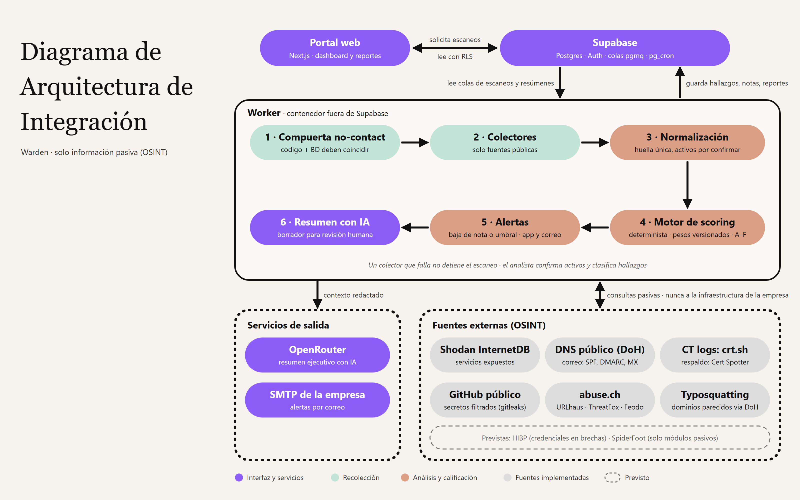

# Warden

Plataforma que califica el riesgo cibernético de una empresa mediante un KRI (puntaje y letra A–F, global y por dominio de riesgo), usando solo información pasiva (OSINT, sin contacto con la infraestructura evaluada).



## Qué hace hoy

- **Escaneos** manuales o programados que consultan solo fuentes públicas, tras una compuerta no-contact.
- **KRI y notas por dominio** con un motor de scoring determinista y pesos versionados.
- **Hallazgos** con evidencia y triage (falso positivo, riesgo aceptado…), e inventario de **activos** por confirmar.
- **Reportes** por escaneo, imprimibles, con resumen ejecutivo generado por IA (OpenRouter, contexto redactado).
- **Alertas** por baja de nota o cruce de umbral, en la app y por correo (SMTP).
- **Usuarios** con roles `analyst` y `admin`.

| Dominio | Fuente implementada |
|---|---|
| `exposure` | Shodan InternetDB |
| `email` | DNS público por DoH (SPF, DMARC, MX) |
| `certs` | crt.sh, con Cert Spotter de respaldo |
| `secrets` | gitleaks sobre repos públicos de GitHub |
| `reputation` | abuse.ch (URLhaus, ThreatFox, Feodo) |
| `impersonation` | Typosquatting vía DNS público |

HIBP y SpiderFoot están previstas, pero aún no se integran al escaneo.

## Estructura

```
apps/web               Next.js (Vercel): dashboard y API ligera
apps/worker            Node en contenedor: cola → colectores → hallazgos → score → alertas → reporte IA
packages/collectors    Integraciones OSINT, una carpeta por fuente + compuerta no-contact
packages/risk-analysis Analizadores de correo y credenciales (aún fuera del escaneo)
packages/scoring       Motor del KRI (funciones puras)
packages/ai            Cliente OpenRouter, prompts versionados, validación y redacción
packages/db            Tipos generados de Supabase
packages/shared        Enums y tipos compartidos
packages/config        tsconfig base
supabase/              Migraciones, seed, función local manage-users y config local
infra/                 docker-compose (worker + SpiderFoot)
docs/                  Arquitectura, ADRs, scoring, fuentes, manuales y diagramas
frontend/              Legado: prototipo del login ya portado a apps/web. No desarrollar aquí
```

## Documentación

| Documento | Contenido |
|---|---|
| [AGENTS.md](AGENTS.md) | Contexto completo del proyecto, reglas de seguridad y convenciones (léelo antes de cambiar código) |
| [docs/manual-instalacion.md](docs/manual-instalacion.md) | Instalación local y en producción (Supabase Cloud, worker, Vercel) |
| [docs/architecture.md](docs/architecture.md) | Componentes y flujo de datos |
| [docs/scoring-model.md](docs/scoring-model.md) | Modelo del KRI |
| [docs/kri-plan.md](docs/kri-plan.md) | Qué está hecho y qué falta del KRI |
| [docs/sources.md](docs/sources.md) | Fuentes OSINT, licencias y por qué son no-contact |
| [docs/risk-analysis.md](docs/risk-analysis.md) | Módulos de análisis de correo y credenciales |
| [docs/local-users.md](docs/local-users.md) | Administración de usuarios locales |
| [docs/adr/](docs/adr/) | Decisiones de arquitectura |
| [docs/diagrams/](docs/diagrams/) | Diagrama de arquitectura y diagrama ER |

## Desarrollo local

Guía paso a paso para correr Warden en tu máquina. Los comandos están en PowerShell (Windows); en macOS/Linux usa `cp` en lugar de `Copy-Item`. Para desplegar en producción, ve el [manual de instalación](docs/manual-instalacion.md).

### 1. Requisitos (una sola vez)

| Herramienta | Para qué | Instalación |
|---|---|---|
| **Node.js 24** | Ejecutar el proyecto | https://nodejs.org |
| **Git** | Clonar el repo | https://git-scm.com |
| **Docker Desktop** | Supabase local corre en contenedores | https://www.docker.com/products/docker-desktop |
| **Supabase CLI v3** (3.0.0 o posterior) | `pnpm db:start`, `db:reset`, `db:types` | `scoop install supabase` (o `npm i -g supabase`); si ya la tienes: `scoop update supabase` |
| **gitleaks** (opcional) | Fuente `gitleaks` si corres el worker fuera de Docker (también requiere `git`) | `scoop install gitleaks` |

Verifica:

```powershell
node --version; docker --version; supabase --version
```

### 2. Clonar e instalar dependencias

```powershell
git clone https://github.com/Warden-OSINT/Warden.git
cd Warden
```

Warden usa **pnpm** (gestor de paquetes con soporte de monorepos), no npm. `corepack`, que viene con Node, instala la versión fijada en `package.json`. Este comando deja `pnpm` en el PATH sin permisos de administrador:

```powershell
corepack enable pnpm --install-directory "$env:APPDATA\npm"
```

Cierra y vuelve a abrir la terminal, y luego:

```powershell
pnpm install
```

### 3. Levantar la base de datos local

Abre **Docker Desktop** y espera a que esté corriendo. Después:

```powershell
pnpm db:start
```

La primera vez tarda unos minutos (descarga imágenes). Aplica migraciones y seeds, e imprime URLs y llaves; puedes volver a verlas con `supabase status`.

### 4. Variables de entorno

```powershell
Copy-Item .env.example .env
```

En **`.env`** (raíz, lo lee el worker) completa:

- `NEXT_PUBLIC_SUPABASE_PUBLISHABLE_KEY`: la **Publishable key** (`sb_publishable_...`).
- `SUPABASE_SECRET_KEY`: la **Secret key** (`sb_secret_...`).

Opcionales del worker (sin ellas el escaneo funciona, pero sin esa parte):

| Variable | Para qué |
|---|---|
| `ABUSECH_AUTH_KEY` | Fuente `abusech`; sin ella la fuente queda `failed`. Gratuita en https://auth.abuse.ch |
| `OPENROUTER_API_KEY`, `OPENROUTER_MODEL` | Resumen ejecutivo con IA en los reportes |
| `CERTSPOTTER_API_KEY` | Mayor límite para el respaldo de crt.sh |
| `SMTP_HOST=127.0.0.1`, `SMTP_PORT=54325`, `ALERT_EMAIL_FROM`, `WARDEN_WEB_URL` | Probar alertas por correo con Mailpit (bandeja local) |

Las llaves de servicios deben ser cuentas de la empresa. El detalle de cada variable está en [.env.example](.env.example).

Crea **`apps/web/.env.local`** (Next.js solo lee variables de su propia carpeta) con **solo** estas líneas:

```
NEXT_PUBLIC_SUPABASE_URL=http://127.0.0.1:54321
NEXT_PUBLIC_SUPABASE_PUBLISHABLE_KEY=sb_publishable_...
WARDEN_DEV_SKIP_AUTH=false
```

> ⚠️ **Nunca pongas `SUPABASE_SECRET_KEY` en `apps/web`.** Es la llave de service role: omite RLS y solo la usa el worker.

### 5. Correr el proyecto

```powershell
pnpm dev
```

| Servicio | URL |
|---|---|
| Web | http://localhost:3000 |
| Supabase Studio (panel de la BD) | http://127.0.0.1:54323 |
| Mailpit (correos de prueba) | http://127.0.0.1:54324 |

Para probar el worker como corre en producción (contenedor con `git` y `gitleaks`), detén `pnpm dev`, arranca solo la web con `pnpm --filter @warden/web dev` y en otra terminal:

```powershell
docker compose -f infra/docker-compose.yml up --build
```

### 6. Iniciar sesión

El seed local crea un admin activo en cada `db:start` / `db:reset`: usuario `admin@warden.test`; la contraseña está en el comentario de [supabase/seeds/dev-admin.sql](supabase/seeds/dev-admin.sql). Solo existe en local; `supabase db push --remote` no ejecuta seeds. Más cuentas: **Configuración → Usuarios** ([docs/local-users.md](docs/local-users.md)).

Para ver el dashboard sin Supabase (datos de ejemplo, sin login), arranca solo la web con `WARDEN_DEV_SKIP_AUTH=true`:

```powershell
$env:WARDEN_DEV_SKIP_AUTH = "true"; pnpm --filter @warden/web dev
```

### 7. Primer escaneo

1. Registra la empresa en el dashboard.
2. En **Activos**, agrega o confirma sus dominios (y organizaciones de GitHub para `gitleaks`). Solo se analizan los activos confirmados.
3. En la tarjeta **Fuentes de datos** del dashboard, habilita las fuentes: **todas vienen deshabilitadas**.
4. Lanza el escaneo y revisa el resultado por fuente en **Escaneos**.

### Comandos del día a día

| Comando | Qué hace |
|---|---|
| `pnpm dev` | Web + worker |
| `pnpm db:start` / `supabase stop` | Prende / apaga Supabase local |
| `pnpm db:reset` | Recrea la BD desde migraciones + seed (**borra datos locales**) |
| `pnpm db:types` | Regenera `packages/db/src/database.types.ts` tras una migración |
| `pnpm typecheck` / `pnpm test` | Lo que corre el CI; debe pasar antes de abrir un PR |

### Problemas comunes

| Síntoma | Solución |
|---|---|
| `Unable to find package manager binary` | `pnpm` no está en el PATH: repite el paso 2 y reabre la terminal. |
| `failed to connect to the docker API` | Docker Desktop no está abierto. |
| `Your project's URL and Key are required` | Falta la llave en `apps/web/.env.local`, o no reiniciaste `pnpm dev`. |
| El worker se cierra al arrancar con un error de validación | Falta o es inválida una variable del `.env` raíz; el mensaje dice cuál (p. ej. `SMTP_HOST` sin `ALERT_EMAIL_FROM`). |
| Inicias sesión pero no ves datos | Tu perfil no está activo; en Studio → SQL Editor: `update public.profiles set role = 'admin', is_active = true where id = (select id from auth.users where email = 'tu@email');` |
| Un escaneo se queda "En cola" | El worker apunta a otra base: `SUPABASE_URL` y `SUPABASE_SECRET_KEY` del `.env` raíz deben ser los de `supabase status` (local), no los de la nube. Reinicia `pnpm dev`. |
| Una fuente sale `skipped` | Está deshabilitada: actívala en **Fuentes de datos**. |
| `abusech` sale `failed` | Falta `ABUSECH_AUTH_KEY` en el `.env` raíz. |
| `gitleaks` sale `failed` en local | Falta `git` o `gitleaks` en tu equipo; instálalos o usa el worker en Docker. |
| Escaneo "Con fallos": `El DNS público (dns.google y Cloudflare) no respondió…` | Warden ya prueba Cloudflare si `dns.google` falla; si fallan los dos, la red bloquea DNS por HTTPS (pasa en la red de la universidad, incluso vía hotspot si el teléfono comparte esa Wi-Fi). Usa datos móviles; si https://api.ipify.org muestra una IP `131.178.x.x`, sigues saliendo por el Tec. El historial está en **Escaneos**. |

### Entornos reales: primer admin

El portal no tiene página de registro. En el panel de Supabase, crea el usuario en **Authentication → Users → Add user** (marca *Auto Confirm User*) y actívalo en **SQL Editor**:

```sql
update public.profiles set role = 'admin', is_active = true
where id = (select id from auth.users where email = 'admin@empresa.com');
```

El despliegue completo está en el [manual de instalación](docs/manual-instalacion.md).

## Flujo de trabajo

- Ramas: `feat/...` / `fix/...` → `dev` → `staging` → `main`. Los PR de trabajo apuntan a `dev`.
- Las tres ramas están protegidas: sin push directo, y el PR exige los checks `check`, `migrations` y `flujo-ramas`.
- Los PR de promoción (`dev → staging`, `staging → main`) se fusionan con merge commit, nunca squash ni rebase.
- Commits en español, en imperativo (p. ej. "Agrega colector de checkdmarc").
- Convenciones de código, base de datos y seguridad: [AGENTS.md](AGENTS.md).
