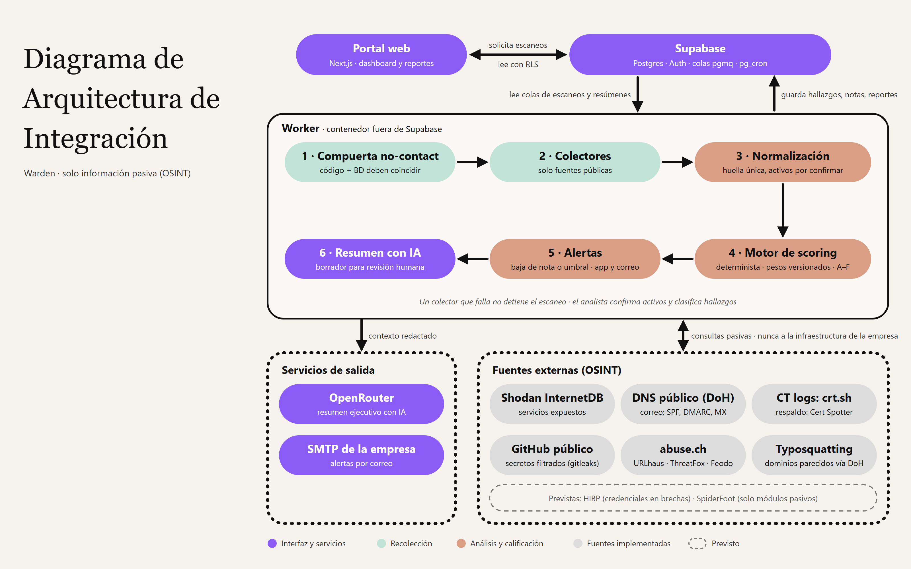

# Arquitectura

Fuente editable: [diagrams/arquitectura-integracion.svg](diagrams/arquitectura-integracion.svg). Modelo de datos: [diagrams/warden_er_diagram.mmd](diagrams/warden_er_diagram.mmd).

## Componentes

| Componente | Dónde corre | Responsabilidad |
|---|---|---|
| `apps/web` | Vercel | Dashboard, empresas, activos, hallazgos, reportes y configuración. Solicita escaneos. |
| `apps/worker` | Contenedor (Railway, Fly o VM) | Consume las colas, ejecuta colectores, persiste hallazgos, calcula el KRI, registra y envía alertas y genera los resúmenes con IA. |
| Supabase | Supabase Cloud o self-hosted | Postgres, Auth, Storage, colas (pgmq) y programación (pg_cron). |
| OpenRouter | Externo | Acceso a modelos de IA para los resúmenes ejecutivos. |
| SMTP de la empresa | Externo | Envío de las alertas por correo. |
| SpiderFoot | Contenedor junto al worker | **Previsto:** motor OSINT, solo con módulos pasivos. Hoy ningún colector lo usa. |

## Flujo de un escaneo

1. **Manual:** la web llama `POST /api/scans`, que ejecuta `request_scan()`.
   **Programado:** `pg_cron` ejecuta `enqueue_due_scans()` cada 15 minutos.
2. Ambos crean una fila en `scans` (`queued`) y encolan `{ scan_id }` en `scan_requests`.
3. El worker lee la cola (`queue_read`) y ejecuta `runScan`:
   - **collect:** cada colector pasa por `checkCollector` (compuerta no-contact) y se registra en `scan_sources`.
   - **persist:** los activos descubiertos quedan `pending`; los hallazgos hacen upsert por `(company_id, fingerprint)` y cada fuente registra `finding_sources.last_seen_scan_id`.
   - **resolve** (`pipeline/resolve.ts`): un hallazgo `open` que su fuente no observó en los últimos `UNSEEN_SCANS_TO_RESOLVE` escaneos con `scan_sources.status = 'ok'` (supuesto: 3) pasa a `resolved` con `status_by = null`. Una fuente fallida, omitida o bloqueada nunca resuelve hallazgos ni cuenta para la racha; `false_positive` y `accepted` no se tocan. Si la fuente vuelve a observarlo, el worker lo reabre (solo los que resolvió él, no los de un analista).
   - **score** (`pipeline/score.ts`): calcula el KRI con `@warden/scoring` sobre los hallazgos `open` y la versión de pesos del escaneo. Solo cuentan los dominios con alguna fuente `ok`; los demás quedan en `scores.excluded_domains` (ver `scoring-model.md`).
   - **alerts** (`pipeline/alerts.ts`): si la nota global baja respecto al puntaje anterior (`grade_drop`) o cruza el umbral de `alert_settings` (`threshold_crossed`), registra como mucho una alerta `in_app` por escaneo. Si hay destinatarios, encola su envío en `integration_outbox` (`destination = 'email'`).
   - **report** (`pipeline/report.ts`): tras calificar se encola `report_requests`; el worker genera el resumen ejecutivo con OpenRouter (contexto redactado: nota, dominios y títulos de hallazgos, nunca evidencia cruda) y lo guarda en `reports` como borrador (`draft`). Un fallo de la IA no tumba el escaneo; la web permite regenerar.
   - **notify** (`pipeline/notify.ts`): cuando no hay escaneos ni resúmenes pendientes, el worker envía los correos de `integration_outbox` por SMTP (`claim_outbox` los aparta 2 min; hasta 5 intentos con espera de 1, 5, 15 y 60 min, luego `failed`). Sin `SMTP_HOST` quedan pendientes. El correo solo lleva notas, KRI y enlace al reporte. El webhook aún no existe.
4. Si el worker muere a mitad del escaneo, el mensaje reaparece al vencer `QUEUE_VISIBILITY_TIMEOUT`. Después de 3 intentos, el escaneo se marca como `failed`.
5. Un miembro puede cancelar un escaneo en cola o en curso (`cancel_scan` → `status = 'cancelled'`). El worker revisa el estado cada 3 s, aborta las consultas en vuelo y no persiste ni califica los resultados parciales.

## Seguridad

- La web usa solo la llave publicable y la sesión del usuario, así que todo pasa por RLS.
- El worker usa la llave secreta (service role). Esa llave nunca debe llegar a Vercel.
- `redact()` limpia el contexto antes de enviarlo a OpenRouter; la evidencia cruda no sale de Warden.
- Los usuarios nuevos se crean con `is_active = false`. Un admin los habilita desde `/settings/users` en desarrollo local.
- La función local `manage-users` usa las APIs de Supabase Auth con una llave administrativa inyectada por su runtime. Verifica el JWT, su emisor local y el perfil admin activo antes de operar. Esa llave no llega a la web. Preparación y límites: [local-users.md](local-users.md).

## Análisis modular de evidencia

`@warden/risk-analysis` contiene contratos generales, validación de objetivos, registro
y ejecutor compartido, más módulos de correo y credenciales en brechas. Los
adaptadores DNS público y HIBP viven en `@warden/collectors`, que depende de
`risk-analysis`; este último depende solo de `shared` y `zod` y no importa de apps.
Los módulos producen observaciones sin scoring ni severidades inventadas.

Estos proveedores son invocables mediante `runRiskAnalysis`, pero todavía no forman
parte de `runScan`, del seed ni del catálogo productivo. Credenciales no se confunde
con el dominio `secrets`: su integración al KRI y la persistencia requieren una
decisión de modelo y migraciones. Alcance, uso y limitaciones en [risk-analysis.md](risk-analysis.md).
