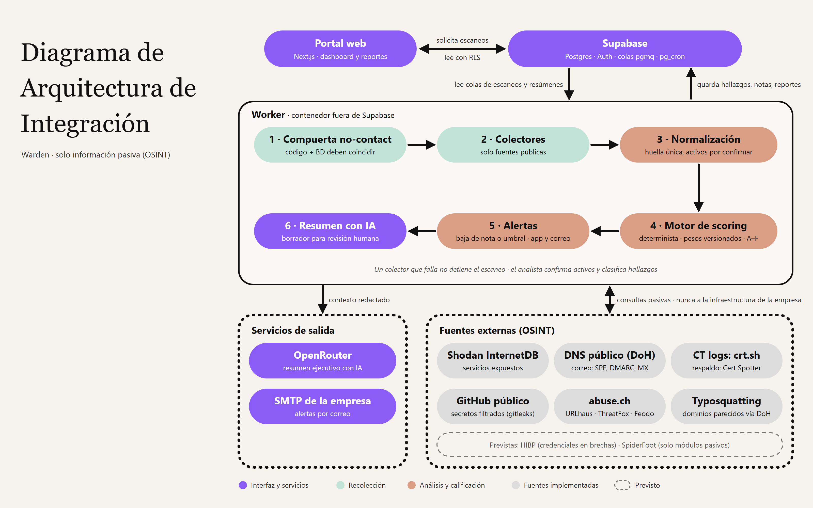

# Warden — Manual de instalación

**Versión del documento:** 1.0 · noviembre 2026

---

## 1. Introducción

### 1.1 Propósito

Este manual explica cómo instalar, configurar y poner en marcha **Warden**, la plataforma que califica el riesgo cibernético de la empresa mediante un KRI (puntaje numérico y letra A–F) usando solo información pública y pasiva (OSINT).

Cubre dos escenarios:

- **Entorno local** (sección 6): para desarrollo, pruebas o demostraciones en un equipo.
- **Entorno de producción** (sección 7): la instalación que usará la empresa.

### 1.2 A quién va dirigido

Al personal de TI de la empresa o al equipo técnico que despliegue y mantenga Warden. Se asume familiaridad básica con la terminal, Git, Docker y variables de entorno. El uso diario de la plataforma se describe en el *Manual de usuario*; el diseño interno, en la *Memoria técnica*.

### 1.3 Componentes que se instalan



| Componente | Qué hace | Dónde se ejecuta |
|---|---|---|
| **Supabase** | Base de datos Postgres, autenticación de usuarios, colas de trabajo (`pgmq`) y tareas programadas (`pg_cron`) | Supabase Cloud (producción) o Docker (local) |
| **Portal web** (`apps/web`) | Dashboard, hallazgos, activos, reportes y configuración | Vercel (producción) o `localhost:3000` (local) |
| **Worker** (`apps/worker`) | Lee la cola, consulta las fuentes OSINT, calcula el KRI, envía alertas y genera el resumen con IA | Contenedor Docker en un servidor (Railway, Fly.io o una VM) |

> **Principio de no-contacto.** Warden nunca envía tráfico a la infraestructura de la empresa evaluada. El worker solo consulta fuentes públicas (registros de certificados, DNS público, feeds de reputación, repositorios públicos). No es necesario abrir puertos ni dar acceso a la red interna de la empresa.

---

## 2. Requisitos previos

### 2.1 Software en el equipo de instalación

| Herramienta | Versión | Para qué |
|---|---|---|
| Node.js | 24 | Ejecutar el proyecto y sus herramientas |
| pnpm | 10 (se instala con `corepack`, incluido en Node) | Gestor de paquetes del monorepo |
| Git | Cualquier versión reciente | Descargar el código |
| Docker Desktop / Docker Engine | Reciente | Supabase local y la imagen del worker |
| Supabase CLI | 3.0.0 o posterior | Aplicar migraciones y administrar la base |

Instalación de la Supabase CLI en Windows: `scoop install supabase` (o `npm i -g supabase`). En macOS: `brew install supabase/tap/supabase`.

Verificación:

```bash
node --version
docker --version
supabase --version
```

### 2.2 Requisitos del servidor del worker

- Capacidad para ejecutar un contenedor Docker de forma continua (Railway, Fly.io, una VM con Docker, etc.).
- **Salida a Internet por HTTPS** hacia las fuentes OSINT. No necesita puertos de entrada.
- Recomendado: 1 vCPU y 1 GB de RAM. El colector de secretos clona repositorios públicos de forma temporal, así que conviene contar con algunos GB de disco libre.
- La red no debe bloquear DNS sobre HTTPS (`dns.google` y `cloudflare-dns.com`). Algunas redes institucionales lo bloquean; ver sección 10.

### 2.3 Cuentas y llaves de servicios

Todas las cuentas deben pertenecer **a la empresa**, no a personas del equipo de desarrollo, para que sigan funcionando cuando termine el proyecto.

| Servicio | Obligatorio | Para qué | Dónde obtenerlo |
|---|---|---|---|
| Supabase | Sí | Base de datos y autenticación | https://supabase.com |
| Vercel | Sí (o cualquier hosting de Next.js) | Portal web | https://vercel.com |
| Hosting de contenedores | Sí | Worker | Railway, Fly.io o VM propia |
| abuse.ch | Recomendado | Fuente de reputación (URLhaus, ThreatFox) | https://auth.abuse.ch (gratuita) |
| OpenRouter | Opcional | Resumen ejecutivo con IA | https://openrouter.ai/keys |
| SMTP de la empresa | Opcional | Envío de alertas por correo | Microsoft 365, Google Workspace u otro |
| SSLMate Cert Spotter | Opcional | Respaldo de crt.sh con mayor límite | https://sslmate.com/signup?for=ct_search_api (gratuita) |
| Have I Been Pwned | No (fuente prevista) | Credenciales en brechas; requiere suscripción y dominio verificado | https://haveibeenpwned.com |

---

## 3. Obtener el código e instalar dependencias

```bash
git clone https://github.com/Warden-OSINT/Warden.git
cd Warden
```

Activar pnpm mediante corepack. En Windows, sin permisos de administrador:

```powershell
corepack enable pnpm --install-directory "$env:APPDATA\npm"
```

En macOS/Linux:

```bash
corepack enable
```

Cerrar y volver a abrir la terminal, y luego instalar las dependencias:

```bash
pnpm install
```

---

## 4. Variables de entorno

La plantilla está en `.env.example`. Warden usa dos juegos de variables, uno por componente, y **nunca deben mezclarse**.

### 4.1 Portal web

| Variable | Obligatoria | Descripción |
|---|---|---|
| `NEXT_PUBLIC_SUPABASE_URL` | Sí | URL del proyecto de Supabase |
| `NEXT_PUBLIC_SUPABASE_PUBLISHABLE_KEY` | Sí | Llave **publicable** (`sb_publishable_...`). Todo acceso pasa por las políticas RLS |
| `WARDEN_DEV_SKIP_AUTH` | No | Solo desarrollo: `true` muestra datos de ejemplo sin login. Debe ser `false` o no existir en producción |

### 4.2 Worker

| Variable | Obligatoria | Descripción |
|---|---|---|
| `SUPABASE_URL` | Sí | URL del proyecto de Supabase |
| `SUPABASE_SECRET_KEY` | Sí | Llave **secreta** (`sb_secret_...`, service role) |
| `ABUSECH_AUTH_KEY` | Para la fuente `abusech` | Auth-Key de abuse.ch |
| `CERTSPOTTER_API_KEY` | No | Mejora el límite del respaldo de crt.sh |
| `OPENROUTER_API_KEY`, `OPENROUTER_MODEL` | Para el resumen con IA | Llave y modelo (p. ej. `proveedor/modelo`; los gratuitos terminan en `:free`) |
| `SMTP_HOST`, `SMTP_PORT`, `SMTP_SECURE`, `SMTP_USER`, `SMTP_PASSWORD` | Para alertas por correo | Servidor SMTP. Puerto 587 con `SMTP_SECURE=false` (STARTTLS) o 465 con `true` |
| `ALERT_EMAIL_FROM` | Si hay `SMTP_HOST` | Remitente, p. ej. `Warden <alertas@empresa.com>` |
| `WARDEN_WEB_URL` | Recomendada | URL pública del portal, para el enlace al reporte en los correos |
| `QUEUE_VISIBILITY_TIMEOUT` | No | Segundos de invisibilidad de un mensaje en proceso (por defecto 900) |
| `HIBP_API_KEY`, `SPIDERFOOT_URL` | No | Fuentes previstas, aún no integradas al escaneo |

El worker valida sus variables al arrancar. Si falta una obligatoria, o se define `SMTP_HOST` sin `ALERT_EMAIL_FROM`, se detiene con un mensaje que indica cuál.

Sin `SMTP_HOST`, las alertas se registran en la aplicación y sus correos quedan pendientes hasta configurarlo. Sin OpenRouter, el reporte se genera igual, pero sin resumen ejecutivo.

### 4.3 Reglas de seguridad

> ⚠️ **`SUPABASE_SECRET_KEY` solo se configura en el worker.** Esta llave omite todas las políticas de seguridad de la base de datos. Nunca debe ponerse en Vercel, en `apps/web`, ni en una variable que empiece con `NEXT_PUBLIC_`.

- Las llaves de las fuentes viven solo como variables del worker. En la base de datos solo se guarda el nombre de la variable, nunca el secreto.
- No subas archivos `.env` al repositorio (ya están excluidos en `.gitignore`).

---

## 5. Base de datos (Supabase)

El esquema completo está versionado en `supabase/migrations/`. El catálogo inicial (dominios de riesgo y fuentes) está en `supabase/seed.sql`.

| Archivo | Contenido | Dónde se aplica |
|---|---|---|
| `supabase/migrations/*.sql` | Tablas, políticas RLS, funciones, colas y tarea programada cada 15 min | Local y producción |
| `supabase/seed.sql` | Catálogo de los 6 dominios de riesgo y de las fuentes (deshabilitadas) | Local y producción |
| `supabase/seeds/dev-admin.sql` | Usuario administrador de desarrollo | **Solo local. Nunca en producción** |

La configuración en local se describe en la sección 6 y en producción en la sección 7.1.

---

## 6. Instalación en entorno local

### 6.1 Levantar Supabase

Abrir Docker Desktop y esperar a que esté en ejecución. Después:

```bash
pnpm db:start
```

La primera vez tarda varios minutos porque descarga imágenes. El comando aplica las migraciones y los seeds, e imprime las URL y llaves locales. Se pueden consultar de nuevo con `supabase status`.

Servicios locales:

| Servicio | URL |
|---|---|
| API de Supabase | http://127.0.0.1:54321 |
| Supabase Studio (panel de la BD) | http://127.0.0.1:54323 |
| Mailpit (bandeja de correos de prueba) | http://127.0.0.1:54324 |

### 6.2 Configurar variables

```bash
cp .env.example .env
```

(En PowerShell: `Copy-Item .env.example .env`.)

En **`.env`** (raíz; lo lee el worker), completar:

- `NEXT_PUBLIC_SUPABASE_PUBLISHABLE_KEY` con la *Publishable key* local.
- `SUPABASE_SECRET_KEY` con la *Secret key* local.
- Opcional, para probar alertas por correo con Mailpit: `SMTP_HOST=127.0.0.1`, `SMTP_PORT=54325`, `ALERT_EMAIL_FROM=Warden <alertas@warden.test>`, `WARDEN_WEB_URL=http://localhost:3000`.

Crear **`apps/web/.env.local`** (Next.js solo lee las variables de su propia carpeta) con **solo** estas líneas:

```dotenv
NEXT_PUBLIC_SUPABASE_URL=http://127.0.0.1:54321
NEXT_PUBLIC_SUPABASE_PUBLISHABLE_KEY=sb_publishable_...
WARDEN_DEV_SKIP_AUTH=false
```

### 6.3 Ejecutar

```bash
pnpm dev
```

Este comando inicia el portal web (http://localhost:3000) y el worker al mismo tiempo.

### 6.4 Iniciar sesión

El seed local crea el administrador de desarrollo `admin@warden.test`, activo y con rol `admin`. Su contraseña está en el comentario de `supabase/seeds/dev-admin.sql`. Desde **Configuración → Usuarios** se pueden crear más cuentas locales (ver `docs/local-users.md`).

### 6.5 Opcional: worker en contenedor

Para probar el worker tal como corre en producción:

```bash
docker compose -f infra/docker-compose.yml up --build
```

En ese caso no ejecutes el worker de `pnpm dev` a la vez. Para levantar solo la web: `pnpm --filter @warden/web dev`. El compose también levanta SpiderFoot, que es una fuente prevista y todavía no la usa ningún escaneo.

---

## 7. Instalación en producción

Orden recomendado: **Supabase → worker → portal web → configuración inicial**.

### 7.1 Supabase Cloud

1. Crear un proyecto en https://supabase.com con la cuenta de la empresa. Elegir una región cercana (p. ej. `us-east`) y guardar la contraseña de la base de datos.
2. Vincular el repositorio con el proyecto. El *project ref* aparece en la URL del panel de Supabase:

   ```bash
   supabase login
   supabase link --project-ref <project-ref>
   ```

3. Aplicar las migraciones:

   ```bash
   supabase db push --remote
   ```

   En un entorno sin terminal interactiva (por ejemplo, un pipeline de CI), agregar `--yes`.

4. Cargar el catálogo. En el panel de Supabase, ir a **SQL Editor**, pegar el contenido de `supabase/seed.sql` y ejecutarlo.

   > ⚠️ No uses `--include-seed` ni ejecutes `supabase/seeds/dev-admin.sql` en producción: crearía un administrador con una contraseña pública.

5. En **Authentication → URL Configuration**, poner como *Site URL* la URL pública del portal (p. ej. `https://warden.empresa.com`).
6. En **Project Settings → API Keys**, copiar la *Publishable key* (para la web) y crear o copiar una *Secret key* (para el worker).

### 7.2 Worker (contenedor Docker)

La imagen incluye Node 24, `git` y `gitleaks`, que necesita el colector de secretos. Se construye **desde la raíz del repositorio**:

```bash
docker build -f apps/worker/Dockerfile -t warden-worker .
```

Crear un archivo de variables solo para el worker, por ejemplo `worker.env` (fuera del repositorio), con las variables de la sección 4.2 apuntando al proyecto de Supabase Cloud. Después ejecutarlo:

```bash
docker run -d --name warden-worker --restart unless-stopped --env-file worker.env warden-worker
```

**En Railway o Fly.io:** conectar el repositorio, indicar `apps/worker/Dockerfile` como Dockerfile con la raíz del repo como contexto, y cargar las variables en el panel del servicio. No hace falta exponer puertos ni dominio.

Ejecuta **una sola instancia**. El worker procesa la cola de forma segura con reintentos, así que una sola es suficiente para una empresa.

### 7.3 Portal web (Vercel)

1. En Vercel, **Add New → Project** e importar el repositorio.
2. Configurar el proyecto:
   - **Root Directory:** `apps/web`.
   - **Framework:** Next.js (se detecta solo). Vercel detecta pnpm por `pnpm-lock.yaml`.
   - Si la instalación no encuentra los paquetes internos `@warden/*`, verificar que esté activada la opción *Include files outside of the Root Directory in the Build Step*.
3. En **Environment Variables**, agregar solo:
   - `NEXT_PUBLIC_SUPABASE_URL`
   - `NEXT_PUBLIC_SUPABASE_PUBLISHABLE_KEY`
4. Desplegar. Opcionalmente, asignar un dominio propio en **Settings → Domains** y actualizar la *Site URL* de Supabase (7.1, paso 5) y `WARDEN_WEB_URL` del worker.

> ⚠️ No agregues `SUPABASE_SECRET_KEY` ni `WARDEN_DEV_SKIP_AUTH=true` en Vercel.

---

## 8. Configuración inicial dentro de Warden

### 8.1 Primer administrador (producción)

En producción no existe el usuario de desarrollo, y el portal no tiene página de registro pública.

1. En el panel de Supabase, **Authentication → Users → Add user → Create new user**, crear la cuenta con el correo del administrador de la empresa (marcar *Auto Confirm User*).
2. En **SQL Editor**, activarla y darle rol de administrador:

   ```sql
   update public.profiles
   set role = 'admin', is_active = true
   where id = (select id from auth.users where email = 'admin@empresa.com');
   ```

Los usuarios nuevos se crean **inactivos** por diseño. Para crear analistas se repite el paso 1 y se activan con la misma consulta, cambiando `'admin'` por `'analyst'`.

> La pantalla **Configuración → Usuarios** del portal solo funciona en el entorno local: depende de una función de Supabase que no debe desplegarse en la nube.

### 8.2 Puesta en marcha

Con la cuenta de administrador, desde el portal:

1. **Registrar la empresa** en el dashboard (nombre y dominio principal).
2. **Activos:** en **Activos**, agregar los dominios, IPs u organizaciones de GitHub de la empresa (los agregados a mano entran confirmados). Solo se analizan los activos **confirmados**. Los que Warden descubra después quedarán pendientes de confirmación.
3. **Fuentes de datos:** en la tarjeta *Fuentes de datos* del dashboard, habilitar las fuentes. Todas vienen deshabilitadas. Una fuente que requiere llave (p. ej. `abusech`) fallará si su variable no está configurada en el worker.
4. **Programación:** en **Configuración → Programación de escaneos**, definir la frecuencia. La base revisa cada 15 minutos qué escaneos tocan.
5. **Alertas:** en **Configuración → Alertas**, definir el umbral y los destinatarios.
6. **Pesos del KRI:** la versión 1 viene cargada y activa; solo se cambia si el equipo acuerda una nueva versión.

---

## 9. Verificación de la instalación

| Prueba | Resultado esperado |
|---|---|
| Abrir la URL del portal | Redirige a la pantalla de inicio de sesión |
| Iniciar sesión con el administrador | Se muestra el dashboard |
| Lanzar un escaneo manual desde el dashboard | Pasa de *En cola* a *Consultando X · n de N* en menos de un minuto |
| Revisar **Escaneos** al terminar | Estado *Completado* y resultado `ok` en cada fuente habilitada |
| Revisar el dashboard | KRI y letra por dominio. Los dominios sin fuente habilitada aparecen como cobertura parcial |
| Abrir **Reportes** | Reporte del escaneo y, si hay OpenRouter, el resumen con IA en borrador |
| Logs del worker (`docker logs warden-worker`) | Sin errores de configuración al arrancar |
| (Opcional) Forzar una alerta bajando el umbral | Alerta en el portal y correo recibido (en local, en Mailpit) |

Antes de entregar una versión modificada del código, verificar también:

```bash
pnpm typecheck
pnpm test
```

---

## 10. Solución de problemas

| Síntoma | Causa probable y solución |
|---|---|
| `Unable to find package manager binary` | pnpm no está en el PATH: repetir el paso de `corepack` y reabrir la terminal |
| `failed to connect to the docker API` | Docker Desktop no está abierto |
| `Your project's URL and Key are required` | Faltan las variables de la web (`apps/web/.env.local` o Vercel); reiniciar o volver a desplegar |
| El worker se detiene al iniciar con un error de validación | Falta o es inválida una variable obligatoria; el mensaje indica cuál (ver sección 4.2) |
| Se inicia sesión pero no se ven datos | El perfil no está activo: ejecutar la consulta de la sección 8.1 |
| Un escaneo se queda *En cola* | El worker no está corriendo o apunta a otra base: revisar `SUPABASE_URL` y `SUPABASE_SECRET_KEY` del worker |
| Fuente en estado `skipped` o `blocked` | La fuente está deshabilitada en la base o no coincide con la compuerta no-contact; habilitarla desde *Fuentes de datos* |
| Fuente `abusech` en `failed` | Falta `ABUSECH_AUTH_KEY` en el worker |
| Error `El DNS público (dns.google y Cloudflare) no respondió…` | La red bloquea DNS sobre HTTPS: ejecutar el worker desde otra red o servidor |
| Los correos de alerta no llegan | Sin `SMTP_HOST` quedan pendientes; revisar credenciales SMTP y `ALERT_EMAIL_FROM`. Tras 5 intentos fallidos el envío queda como `failed` |
| No aparece el resumen con IA | Faltan `OPENROUTER_API_KEY` u `OPENROUTER_MODEL`; el reporte permite *Regenerar* una vez corregido |
| El escaneo de secretos (`gitleaks`) falla en local | Fuera del contenedor, `git` y `gitleaks` deben estar instalados en el equipo |

---

## 11. Actualización y mantenimiento

### 11.1 Actualizar a una nueva versión

1. Descargar los cambios: `git pull` sobre la rama `main`.
2. Si hay migraciones nuevas, aplicarlas: `supabase db push --remote`. Hacerlo **antes** de desplegar el worker y la web.
3. Reconstruir y reiniciar el worker (`docker build …` y `docker run …`, o volver a desplegar en Railway/Fly).
4. Vercel vuelve a desplegar la web automáticamente al recibir cambios en la rama configurada.

Nunca se edita una migración ya aplicada; los cambios de esquema siempre llegan como migraciones nuevas.

### 11.2 Respaldos

- Supabase Cloud realiza respaldos automáticos según el plan contratado (**Database → Backups**).
- Para un respaldo manual: `supabase db dump --remote -f respaldo.sql`.

### 11.3 Rotación de llaves

Si una llave se expone, revocarla en su servicio, generar una nueva y actualizar la variable en el worker (o en Vercel, en el caso de la llave publicable). Después, reiniciar o volver a desplegar.

### 11.4 Apagar el entorno local

```bash
supabase stop
```

Los datos locales se conservan. `pnpm db:reset` recrea la base desde cero y **borra los datos locales**.
